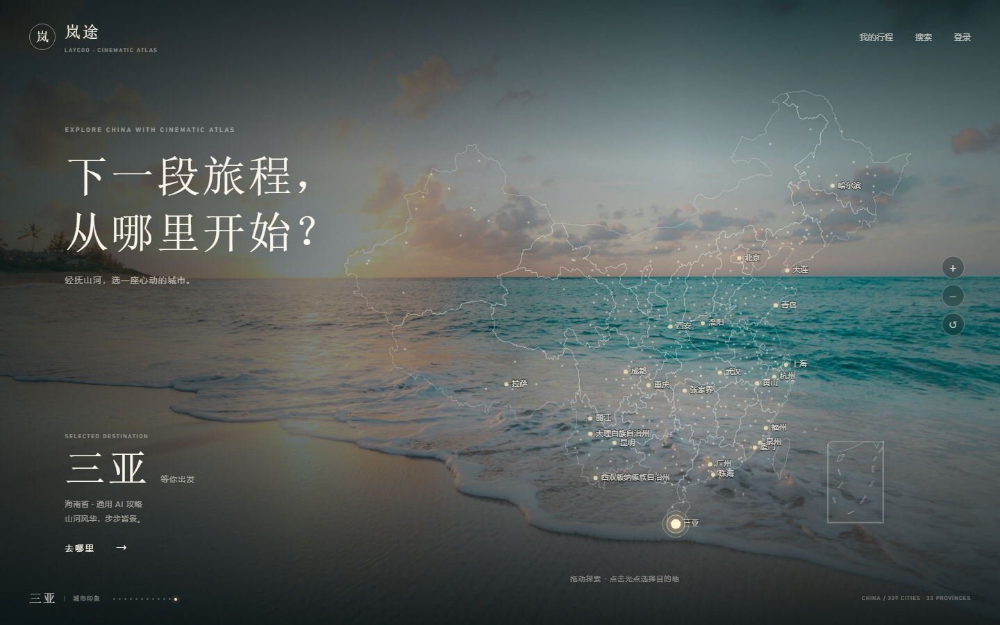
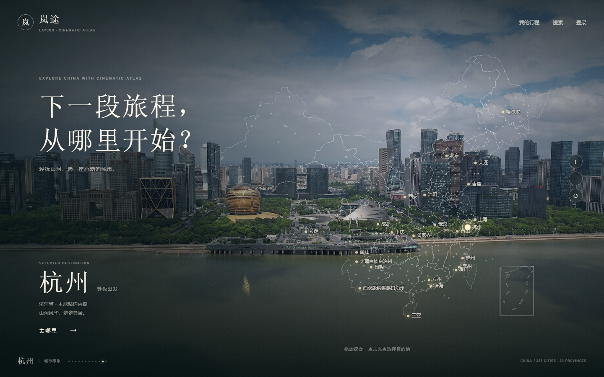
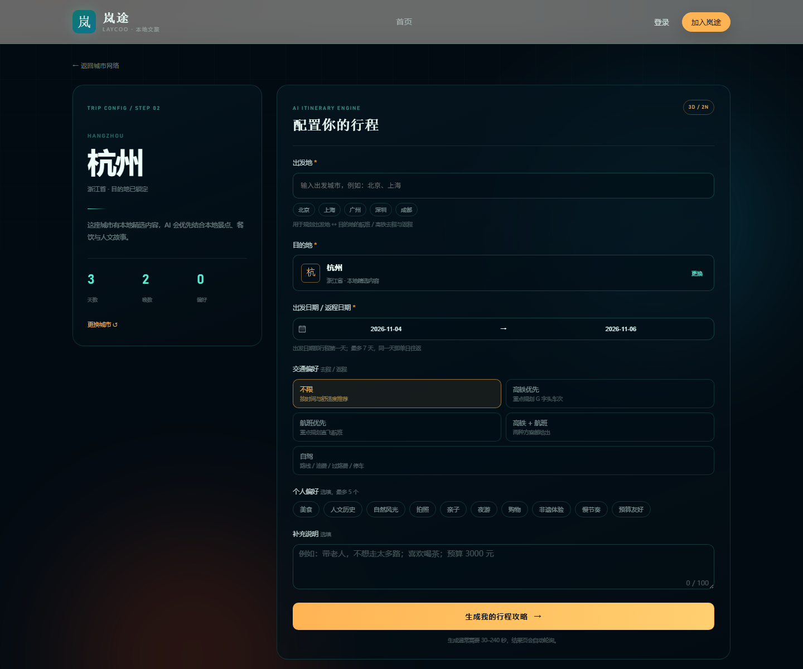
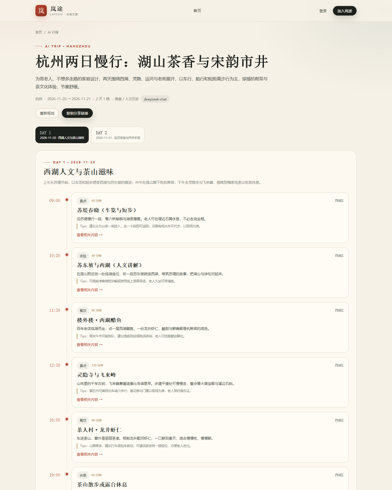

# 岚途 LayCoo · 前端工程

GitHub：https://github.com/BlackMonsterQQ/lay-coo-frontend

Vue 3 + Vite + TypeScript + Pinia + Vue Router + Element Plus + ECharts。

本仓库只包含前端。后端是独立仓库 [lay-coo-backend](https://github.com/BlackMonsterQQ/lay-coo-backend)，本仓库通过 Vite 代理访问网关 `http://localhost:8080`。

## 界面预览









更多截图见 `screenshots/`。

## 用 WebStorm 打开

直接打开本仓库根目录：

```text
E:\laycoo\frontend
```

WebStorm 会通过 `package.json` 自动识别为 npm 项目。

## 启动

```powershell
npm.cmd install
npm.cmd run dev
```

打开 http://localhost:5173 。

> Windows 下如果 PowerShell 禁止运行 `npm.ps1`，使用 `npm.cmd`，或把 WebStorm 的 Terminal 切换为 cmd。

## AI 多日行程规划

首页已改为「中国城市网络」：

- 首页只保留城市选择，不再放日期与偏好表单；表单移到 `/plan/new?city=...`
- 中国地图使用 ECharts Geo + 339 个城市光点，覆盖地级及以上城市（含港澳）
- 首页为深色电影感界面，选中城市后背景切换为该城市地标影像；图片由后端 `/api/v1/city/{code}/image` 代理 Wikipedia 并缓存，避免浏览器跨域与代理问题
- 支持城市 / 省份搜索、热门城市快捷选择、地图缩放与聚焦
- 地图数据在 `src/assets/maps/china.json`，本地加载，不依赖 CDN
- 提交后创建异步行程任务，跳转 `/plan/:planNo`
- 结果页按天展示时间轴、餐饮、交通、预算、雨天备选
- 生成中自动轮询，失败可重试

## 与后端联调

- 开发服务器把 `/api` 代理到 `http://localhost:8080`（网关），配置见 [vite.config.ts](vite.config.ts)。
- 启动前端前，需要先启动后端 gateway 及对应微服务。
- 行程生成需要后端 ai-service 配置 DeepSeek Key；未配置时后端会使用内置模板生成演示行程。
- 登录接口返回 JWT，前端保存在 `localStorage`，Axios 请求拦截器自动附加 `Authorization: Bearer <token>`。

## 构建

```powershell
npm.cmd run build
```

产物在 `dist/`。生产环境需要把 `/api` 反向代理到网关。

## 目录

```text
src/
├─ api/          # Axios 封装与接口定义
├─ assets/maps/  # 中国地图 GeoJSON
├─ components/   # 通用组件
├─ components/plan/ # 中国城市网络、地标背景、行程表单、时间轴
├─ router/       # 路由与登录/管理员守卫
├─ stores/       # Pinia 状态
├─ styles/       # 全局样式与设计变量
├─ types/        # TypeScript 类型
├─ utils/        # 格式化等工具
└─ views/        # 页面（含 PlanResultView）
```

## 演示账号

- `admin / admin123`（管理员）
- `demo / demo123`（普通用户）
